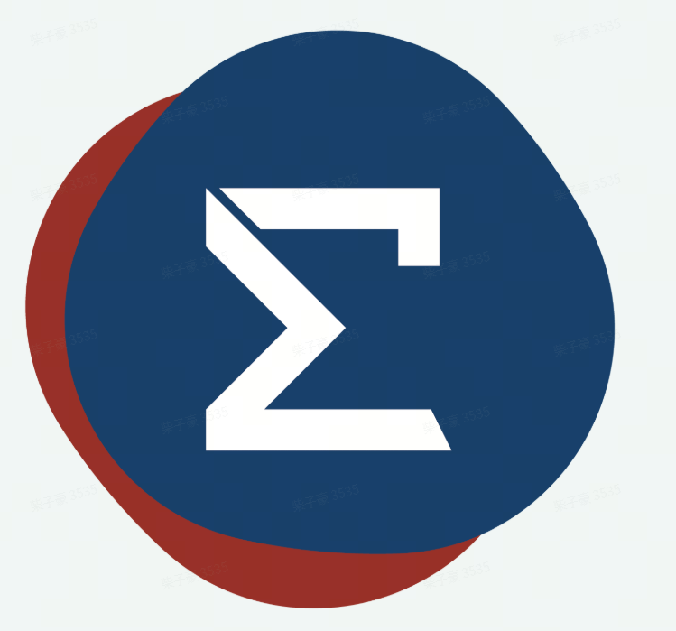

<!-- project-header:start -->
<p align="center">
  
</p>
<h1 align="center">smrcore_peripherals</h1>
<p align="center"><strong>SpaceMouse、六维力传感器、Pico 和主从臂的外设接入库与机器人应用示例。</strong></p>
<p align="center">
  <a href="LICENSE"></a>
  <a href="https://zhanhui-li-smore.github.io/smrcore_peripherals/zh/"></a>
  <a href="https://github.com/zhanhui-li-smore/smrcore_peripherals/actions/workflows/ci.yml"></a>
  <a href="https://github.com/zhanhui-li-smore/smrcore_peripherals/releases/latest"></a>
</p>
<p align="center"><a href="README.en.md">English</a> · <strong>简体中文</strong></p>

---
<!-- project-header:end -->

本仓库提供外设读取、协议处理和应用示例。读取库独立于机器人 SDK；机器人控制由应用组合配套 SDK 完成。

## 接入链路

| 外设 | 读取 | 机器人接入 |
|---|---|---|
| [SpaceMouse](docs/site/spacemouse.md) | C++ / Python | SDK Peripheral 样本接口 |
| [六维力传感器](docs/site/ft-sensor.md) | C++ / Python | SDK Peripheral 样本接口与标定 |
| [Pico](docs/site/pico.md) | C++ / Python | 双臂 ServoP 与夹爪；Python 可启动同一 C++ 程序 |
| [主从臂](docs/site/zhonglin.md) | Python | SDK ServoJ 从臂跟随 |

## 下载与文档

- [Release 下载](https://github.com/zhanhui-li-smore/smrcore_peripherals/releases)：编译包、Python wheel、中英文说明书和校验和。
- [选择制品与 SDK 兼容性](docs/releases.md)：两种 C++ 包如何选、Python 依赖与各链路交付形式。
- [在线文档](https://zhanhui-li-smore.github.io/smrcore_peripherals/zh/) · [C++ 示例](app/README.md) · [Python 示例](python/app/README.md)。

## 从源码开始

```bash
git clone https://github.com/zhanhui-li-smore/smrcore_peripherals.git
cd smrcore_peripherals
python3 -m pip install 'conan>=2,<3'
./scripts/build.sh --with-sdk OFF --tests ON
./scripts/run_tests.sh -t Release
./build_Release/bin/app_peripherals_probe
```

Python 读取库在 C++ 构建后安装：

```bash
./scripts/build_py.sh --no-install
python3 -m pip install --force-reinstall python/dist/*.whl
```

也可以直接下载匹配版本的预编译包。运行机器人应用前按对应链路文档安装配套 SDK，并核对构型和设备参数。

## 许可证与运行要求

仓库采用 [Apache License 2.0](LICENSE)。SDK 运行库和文档模板保留各自许可与归属说明。设备读取需要相应权限；运动应用需确认工具、工作区和急停。支持的平台、SDK 和验证范围见[版本说明](docs/releases.md)。
